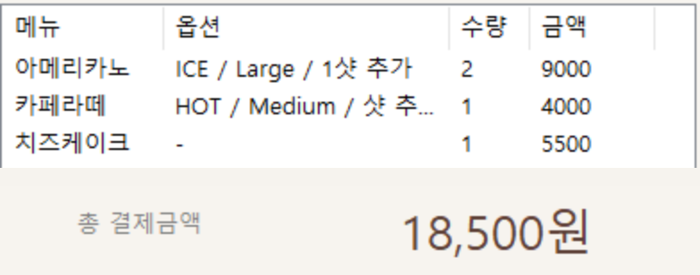
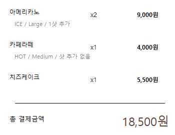
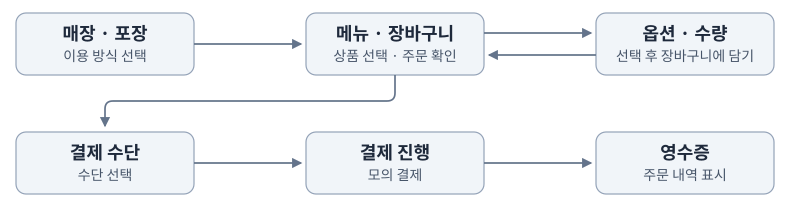
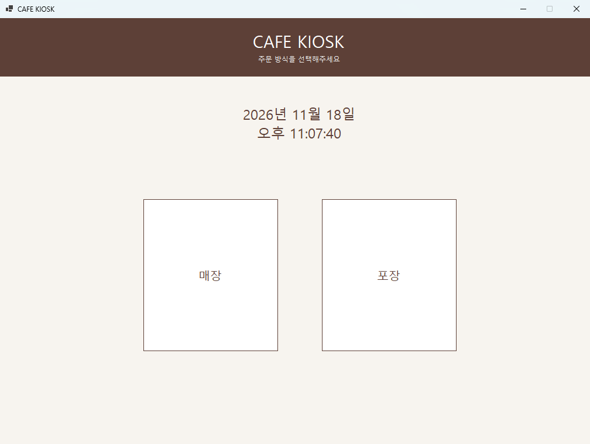
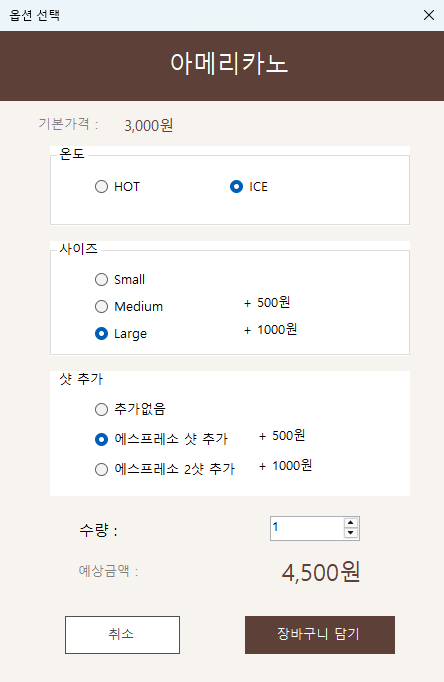

# Cafe Kiosk

C# WinForms로 만든 카페 주문 키오스크입니다. 매장·포장 선택부터 메뉴 주문, 결제, 영수증까지 혼자 만든 개인 프로젝트입니다.


| 장바구니 | 영수증 |
|:---:|:---:|
|  |  |

## 프로젝트 소개

- 기간: 2026.07.30 ~ 2026.07.31
- 인원: 1명

## 화면 흐름



<p align="center">
  
</p>

| 음료 옵션 | 결제 수단 |
|:---:|:---:|
|  |  |

## 주요 기능

- **메뉴 선택**: 매장·포장 선택값을 메뉴 화면으로 넘기고, 커피·에이드·디저트를 탭으로 나눴습니다.
- **옵션 선택**: 음료는 온도, 크기, 샷 추가, 수량을 고르고 디저트는 수량만 고릅니다. 옵션을 바꾸면 금액이 바로 바뀝니다.
- **장바구니**: ListView에 담고, 메뉴와 옵션이 같으면 한 줄로 합칩니다. 비어 있으면 결제로 넘어가지 않습니다.
- **결제**: 결제 수단을 고르면 패널 색이 바뀌고, Timer와 ProgressBar로 결제 진행을 흉내 냅니다. 끝나면 주문 번호를 올려 영수증으로 넘깁니다.
- **영수증**: 주문 항목 수에 맞춰 창 높이를 조절하고, 너무 길면 스크롤합니다.

## 문제 해결

### 장바구니 항목 중복
- **문제**: 메뉴와 옵션이 같은 상품이 여러 줄로 나뉘어 주문 내역을 보기 어려움
- **해결**: 담을 때 메뉴명과 옵션이 같은 줄을 찾아 수량과 금액을 합치고 총 금액을 다시 계산. 위 사진의 아메리카노 2잔(ICE·Large·1샷 추가)이 한 줄 9,000원으로 합쳐진 예

### 주문 항목 수에 따른 영수증 화면
- **문제**: 주문이 많으면 영수증 창이 화면 밖으로 나가고, 적으면 빈 공간이 남음
- **해결**: 항목 높이에 맞춰 창 크기와 아래쪽 버튼 위치를 다시 계산하고, 최대 높이를 넘으면 스크롤

## 파일 구성

```
src/
├── OrderTypeForm.*         # 매장·포장 선택
├── MenuForm.*              # 메뉴, 장바구니, 총금액
├── DrinkOptionForm.*       # 음료 옵션
├── DessertOptionForm.*     # 디저트 수량
├── PaymentForm.*           # 결제 수단 선택
├── PaymentProgressForm.*   # 결제 진행
├── ReceiptForm.*           # 영수증
└── Resources/              # 메뉴·결제 수단 이미지 (생성형 AI로 만든 이미지)
```

## 실행

Windows, .NET 6(`net6.0-windows`) 프로젝트입니다. Visual Studio에서 `src/Kiosk.sln`을 열고 실행하면 됩니다.

<!-- 시연 영상 링크 넣을 곳 -->
